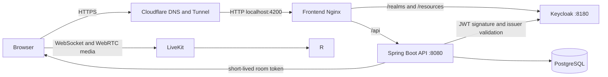

# Project flow and integration setup

This folder explains how the main services fit together, what is already configured, and how to move from local development to an Internet accessible deployment. Read the guides in this order:

1. [Backend architecture and development guide](../BACKEND_ARCHITECTURE.md)
2. [Project flow](#request-and-service-flow)
3. [Domain and Cloudflare](domain-cloudflare.md)
4. [Authentication and Keycloak](authentication.md)
5. [LiveKit media](livekit.md)
6. [Redis](redis.md)

Each guide labels the current repository setup separately from production or planned work. File paths are relative to the repository root.

## Request and service flow

The browser loads Angular through Nginx. Nginx routes API requests to Spring Boot and Keycloak paths to the Keycloak service. The API validates the browser's Keycloak-issued access token before serving protected endpoints. PostgreSQL stores application data. Redis is configured for LiveKit; the backend has Redis connection settings but currently contains no feature code that reads or writes Redis. When the user activates microphone, room audio, or screen sharing, the browser connects directly to the LiveKit URL in the token response. Cloudflare Tunnel publishes the web routes; it does not proxy the UDP/TCP WebRTC media path.

## Current implementation at a glance

| Area | Current setup | Main references |
|---|---|---|
| Domain and edge | `letscook.world` and `www` use Cloudflare DNS and a named Tunnel to local frontend port 4200. Local tunnel config and credentials are machine-local. | `.cloudflared/config.yml` (ignored/local), `frontend/nginx.conf`, `scripts/start-cloudflare-uat.ps1` |
| Authentication | Keycloak realm `lets-cook`; Angular uses OIDC client `lets-cook-web`; Spring Boot validates JWTs and issuer values. | `infra/keycloak/realm-export.json`, `frontend/src/app/core/auth.service.ts`, `backend/src/main/java/com/letscook/platform/config/SecurityConfig.java` |
| Media | Bundled LiveKit on port 7880 for local/LAN. Optional public LiveKit Cloud endpoint can be configured for remote media. | `compose.yaml`, `infra/livekit/livekit.yaml`, `scripts/configure-livekit-cloud.ps1` |
| Redis | Redis 7.4 container with AOF persistence and a named Docker volume. LiveKit is configured to connect; backend has the Spring Data Redis dependency and connection settings, but no feature code currently uses Redis commands. | `compose.yaml`, `infra/livekit/livekit.yaml`, `infra/livekit/livekit-public.yaml`, `backend/pom.xml`, `backend/src/main/resources/application.yml` |

## Suggested setup sequence

1. Start the app locally and verify its services with `docker compose ps`.
2. Configure Keycloak's public URL, realm/client redirect URIs, and secret admin credentials for the public hostname.
3. Route the domain through Cloudflare to the frontend gateway; verify both apex and `www` HTTPS.
4. Choose a media hosting path: LiveKit Cloud, or self-hosted LiveKit with a reachable public IP, DNS, firewall and router rules, and TURN as needed.
5. Configure production Redis/PostgreSQL persistence, passwords, backups, and network access before handling real users.

The checked-in compose defaults and example credentials are for development. Do not treat them as production secrets or as a complete production deployment.
