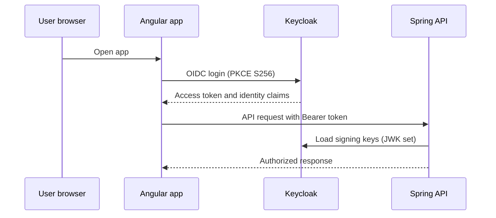

# Authentication setup (Keycloak and JWT)

## Purpose and flow

Keycloak handles sign-in and issues OIDC access tokens. Angular sends the access token to the API. Spring Security checks the token signature using Keycloak's JWK endpoint and checks the issuer claim against configured accepted issuers. The API remains responsible for authorization of each application operation.



## Current implementation

- Realm: `lets-cook`.
- Browser client: `lets-cook-web`.
- Angular uses Keycloak JS, OIDC authorization-code flow with PKCE S256, and checks SSO on initialization.
- Nginx exposes Keycloak realm/resources paths on the same public origin as the app.
- Spring Boot is an OAuth2 resource server. It validates JWTs and allows local/LAN, permanent-domain, and trycloudflare test issuers in `SecurityConfig.java`.
- Authenticated application requests use JWT claims through backend helpers/controllers; the backend synchronizes/looks up the local app profile rather than using Keycloak as the application's room database.
- Optional Google and X sign-in are configured as Keycloak identity providers. Web and Android send an identity-provider hint to Keycloak; Android uses Authorization Code + PKCE through its dedicated public OIDC client.
- Compose currently uses Keycloak `start-dev`, imports the realm file, and has development defaults. These are not production-ready.

## Where each part lives

| Concern | File or setting | What it does |
|---|---|---|
| Realm, clients, roles, test identity | `infra/keycloak/realm-export.json` | Keycloak realm import, including `lets-cook` and `lets-cook-web` client configuration |
| Browser login and token refresh | `frontend/src/app/core/auth.service.ts` | Initializes OIDC, starts login/logout, and refreshes tokens |
| API bearer token attachment | `frontend/src/app/core/api.service.ts` | Gets an access token from `AuthService` and sends it on authenticated API requests |
| Browser-to-Keycloak/API paths | `frontend/nginx.conf` | Routes same-origin Keycloak and API requests |
| JWT validation and issuer allowlist | `backend/src/main/java/com/letscook/platform/config/SecurityConfig.java` | Validates bearer JWTs and configures authorization rules |
| Current user/profile mapping | `backend/src/main/java/com/letscook/platform/common/CurrentUserService.java`, `backend/src/main/java/com/letscook/platform/common/ProfileController.java` | Maps verified token claims to the local user profile and profile endpoints |
| JWK URL, issuer, proxy headers | `backend/src/main/resources/application.yml`, `compose.yaml` | Sets service-side issuer/JWK and forwarded-header behavior |
| Temporary public UAT redirects | `infra/scripts/dev/start-cloudflare-uat.ps1` | Rewrites the browser client's redirect/origin arrays for a Quick Tunnel URL |
| Social identity providers | `infra/scripts/prod/enable-google-login.ps1`, `infra/scripts/prod/enable-x-login.ps1` | Configure Google and X in Keycloak; credentials belong in protected configuration, not source |
| Mobile OIDC client | `infra/scripts/prod/ensure-mobile-oidc-client.ps1`, `infra/keycloak/realm-export.json` | Registers the Android PKCE callback `world.letscook.app:/oauthredirect` |
| UAT account provisioning and login checks | `backend/scripts/dev/seed-uat-users.ps1`, `backend/scripts/dev/run-uat.ps1` | Creates local test users and runs auth/API/media UAT flows |

## Setup sequence

1. Start Keycloak with the realm import for local development (`docker compose up -d`).
2. Verify the realm's web client has correct redirect URIs and web origins for the active origin. Use exact HTTPS domain origins for the named tunnel; avoid broad wildcards in production.
3. Set Keycloak's public hostname and trusted proxy-header behavior for the actual Cloudflare-to-Nginx-to-Keycloak topology. Forwarded headers must be supplied only by trusted proxies.
4. Set the API's issuer to the canonical Keycloak issuer, and make the JWK endpoint reachable from the backend container. Keep token issuer validation narrow; remove temporary tunnel patterns and unused LAN URLs when no longer needed.
5. Replace development admin credentials and use production Keycloak mode, TLS/proxy settings, database persistence, and backups before launch.
6. Test login, logout, refresh, invalid/expired token rejection, and API authorization using a non-admin account.

## Enable social login

Create OAuth applications with Google and X, register the callback URLs printed by these commands, and then configure Keycloak without committing the credentials:

```powershell
.\infra\scripts\prod\ensure-mobile-oidc-client.ps1
.\infra\scripts\prod\enable-google-login.ps1 -ClientId '<google-client-id>' -ClientSecret '<google-secret>'
.\infra\scripts\prod\save-x-oauth-credential.ps1 -Kind ClientId
.\infra\scripts\prod\save-x-oauth-credential.ps1 -Kind ClientSecret
.\infra\scripts\prod\enable-x-login.ps1
```

Google uses its OAuth client ID/secret. X uses a confidential OAuth 2.0 Web App with PKCE and the production callback `https://xynk.in/realms/xynk/broker/x/endpoint`. The X app needs `users.read` and `tweet.read`; current Keycloak versions require an eligible X API v2 plan for the user-info call. Use the canonical public Keycloak URL when configuring production so the generated broker callback URLs are public HTTPS URLs.

Google uses a provider-specific first-login flow: create a user when the verified email is new, or automatically link the Google identity when it matches an existing verified Keycloak email. This deliberately trusts Google's verified-email assertion and must not be assigned to an untrusted provider. The native Android exchange enforces the same verified-email rule.

The X setup script copies Keycloak's standard first-broker-login flow into an X-only flow and disables its Review Profile step. This is intentional because X commonly does not supply an email address. X accounts are keyed by the provider identity/handle and may have a null application email. Google continues to use the standard first-login behavior and verified email.

## Future authentication work

The repo currently has a development-focused Keycloak deployment and a hard-coded issuer allowlist. Production setup should externalize the canonical issuer, use a stable hostname, tighten redirect URI/origin entries, configure a durable database, and store secrets outside checked-in files. Review the realm export before changing client flow settings so the Angular PKCE configuration and Keycloak client agree.
